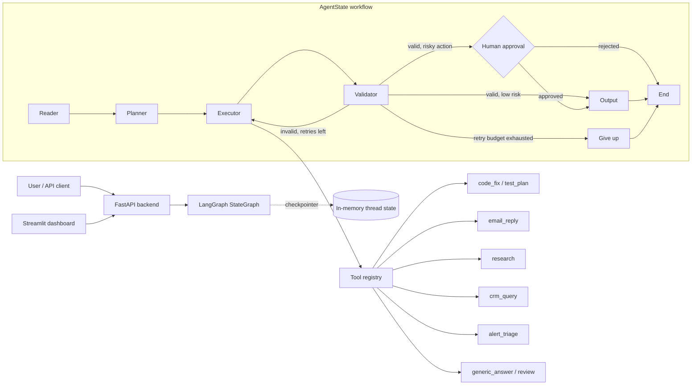
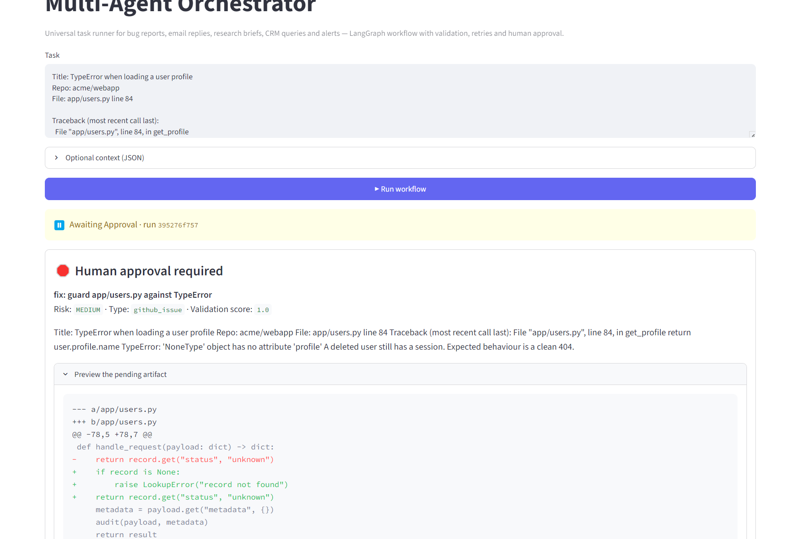

# Multi-Agent Orchestrator

A general-purpose, human-in-the-loop multi-agent system built with **LangGraph**, **FastAPI**, **Streamlit**, and **Pydantic**. Give it a GitHub issue, an email, a research question, a CRM request, or an alert; a team of specialised agents reads it, plans, executes tools, validates the result, asks a human for approval when the action is risky, and delivers a final artifact.

The project runs fully **offline with no API keys**. A deterministic engine powers every agent so the demo and test suite are reproducible. Set `LLM_PROVIDER=openai` to delegate reasoning to an OpenAI-compatible model; schema validation and deterministic guardrails stay in place.

---

## Contents

- [Features](#features)
- [Architecture](#architecture)
- [Project layout](#project-layout)
- [Quickstart](#quickstart)
- [Docker](#docker)
- [Dashboard](#dashboard)
- [API](#api)
- [Example workflows](#example-workflows)
- [Configuration](#configuration)
- [Reliability model](#reliability-model)
- [How the graph works](#how-the-graph-works)
- [Extending the system](#extending-the-system)
- [Tests](#tests)
- [Limitations and production hardening](#limitations-and-production-hardening)

---

## Features

| Capability | Implementation |
| --- | --- |
| Universal state | `AgentState` dataclass: `task → context → plan → action → result → output` plus logs, attempts, approval, metrics |
| Modular agents | Reader, Planner, Executor, Validator, Output |
| Orchestration | LangGraph `StateGraph` with conditional edges, correction loop, explicit terminal states |
| Human approval | LangGraph `interrupt()` + checkpointer; resume through `POST /approve` |
| Reliability | Per-agent timeouts, node-level retries with backoff, LLM retries, 3-attempt validation loop, graceful offline fallback |
| Schema validation | Pydantic v2 models at API, LLM, plan, state, and tool boundaries |
| Tool registry | Code fix/PR, test plan, email draft, research brief, CRM query, alert triage, generic answer, review |
| Observability | Typed `LogEntry` events in state, duration/attempt data, structured server logs, full state in UI |
| Backend | FastAPI: `/run`, `/approve`, `/runs`, `/runs/{id}`, `/graph`, `/health`, OpenAPI docs |
| Frontend | Streamlit: task input, sample workflows, status banner, colour-coded graph, approval panel, final artifact, logs |
| Deployment | Multi-service Docker Compose: API + dashboard, health checks, non-root image |
| Tests | 23 pytest tests covering classification, planning, validation, retries, timeouts, approval, rejection, and HTTP |

---

## Architecture



The six contract fields flow through every node:

```text
task ──▶ context ──▶ plan ──▶ action ──▶ result ──▶ output
        (Reader)   (Planner) (Executor) (Executor) (Output)
                                   │
                                   └── Validator ──▶ retry / approve / deliver
```

### Agent responsibilities

| Agent | Responsibility | Offline engine | LLM mode |
| --- | --- | --- | --- |
| **Reader** | Classify task (`github_issue`, `email`, `research`, `alert`, `crm`, `generic`), extract entities/constraints, assess risk, flag approval | Keyword scoring + regex entity extraction | JSON-mode schema-validated LLM |
| **Planner** | Choose `simple` vs `complex`, order tool steps, define acceptance criteria | Complexity signals + task-to-tool map | LLM plan validated against allowed tools |
| **Executor** | Run plan steps through the tool registry, merge artifacts | Deterministic tools | Deterministic tools (the executor does not fabricate tool output) |
| **Validator** | Check artifact completeness/correctness, score, produce retry feedback | Rule-based critical checks + placeholder scan | Rules **and** LLM judge; both must pass |
| **Output** | Compose final deliverable (PR, email, report, triage, CRM result) | Structured Markdown templates | LLM composition with link/kind guardrails |

---

## Project layout

```text
agent-orchestrator/
├── state.py             # Pydantic contracts + universal AgentState dataclass
├── agents.py            # Reader, Planner, Executor, Validator, Output
├── tools.py             # Tool registry and tool implementations
├── workflow.py          # LangGraph StateGraph, routing, retries, approval, graph spec
├── app.py               # FastAPI application factory and endpoints
├── dashboard.py         # Streamlit dashboard
├── config.py            # Environment settings and logging
├── llm.py               # OpenAI JSON client with validation + retries
├── requirements.txt
├── Dockerfile
├── docker-compose.yml
├── pytest.ini
├── .env.example
├── .streamlit/config.toml
├── tests/
│   ├── test_agents.py
│   ├── test_workflow.py
│   └── test_api.py
└── README.md
```

---

## Quickstart

**Requirements:** Python 3.11+ (tested with 3.12 and 3.13), a terminal, no API key.

```bash
cd agent-orchestrator

python -m venv .venv
source .venv/bin/activate          # Windows PowerShell: .venv\Scripts\Activate.ps1
pip install -r requirements.txt

# Optional: copy and edit configuration
cp .env.example .env               # Windows: copy .env.example .env
```

Start the backend:

```bash
uvicorn app:app --reload --host 127.0.0.1 --port 8000
```

Start the dashboard in a second terminal (same virtualenv):

```bash
streamlit run dashboard.py
# or: API_URL=http://127.0.0.1:8000 streamlit run dashboard.py
```

Open:

- Dashboard: <http://localhost:8501>
- API docs: <http://localhost:8000/docs>
- Health: <http://localhost:8000/health>

No keys are needed. With `LLM_PROVIDER=offline`, artifacts are generated by the deterministic engine and are clearly labelled where they are simulated (for example, PRs).

### Optional: use an LLM

```bash
# .env
LLM_PROVIDER=openai
OPENAI_API_KEY=sk-...
OPENAI_MODEL=gpt-4o-mini
# OPENAI_BASE_URL=https://your-compatible-endpoint/v1
```

Restart the API. Every model response is parsed as JSON and validated against its Pydantic schema. Invalid output is retried; if the provider still fails, that agent falls back to its deterministic engine instead of crashing the run.

---

## Docker

Build once, run both services:

```bash
docker compose up --build
```

| Service | URL | Health check |
| --- | --- | --- |
| `api` | <http://localhost:8000> | `/health` |
| `dashboard` | <http://localhost:8501> | `/_stcore/health` |

The dashboard talks to the API at `http://api:8000` inside the Compose network. The demo CRM is stored in the named volume `crm-data` at `/app/data/crm.db`.

Pass an LLM key to Compose through your shell or a local `.env` file (Compose reads it for interpolation, but it is not baked into the image):

```bash
LLM_PROVIDER=openai OPENAI_API_KEY=sk-... docker compose up --build
```

The API deliberately runs with **one worker** because the demo uses LangGraph's in-memory checkpointer. See [Production hardening](#limitations-and-production-hardening).

---

## Dashboard

The Streamlit dashboard provides:

1. **Task input** — any task, with an optional JSON context box (`from`, `subject`, `repo`, `service`, `company`, …).
2. **Example tasks** — one click loads a GitHub issue, email, research query, or alert.
3. **Workflow visualization** — Graphviz rendering of the actual graph spec from `/graph`, with nodes colour-coded as completed, active, failed, or pending. Conditional edges are dashed.
4. **Approval panel** — appears for risky actions. Shows risk, validation score, artifact preview, reviewer, comment, and approve/reject controls.
5. **Final output panel** — rendered Markdown, links (PR or mail client), confidence, attempts, download buttons for Markdown and `.diff`.
6. **Logs panel** — chronological agent events with durations, retry/failure details, JSON event data, and a raw log view.
7. **Inspection tabs** — full state, plan, result artifact, validation output, and errors.
8. **Run history** — reload any run from the in-process API registry.

The dashboard uses only the public API; it can run on a different host from the backend.



---

## API

### `POST /run`

Start a run. The call returns when the workflow completes **or** pauses at the approval gate.

```bash
curl -s http://localhost:8000/run \
  -H 'content-type: application/json' \
  -d '{
    "task": "Research the trade-offs between event-driven and request-response architectures for a payments platform.",
    "auto_approve": true,
    "max_attempts": 3
  }'
```

Request body:

| Field | Type | Default | Meaning |
| --- | --- | --- | --- |
| `task` | string (1–20,000 chars) | required | The issue, email, question, alert, or request |
| `context` | object | `{}` | Optional structured context |
| `auto_approve` | boolean or null | server default | Skip the human gate for risky actions |
| `max_attempts` | int 1–10 or null | 3 | Executor↔Validator correction loops |
| `metadata` | object | `{}` | Caller tags stored with the run |

Response (`RunResponse`):

```json
{
  "run_id": "893ae4368f...",
  "status": "awaiting_approval",
  "task": "Draft a reply to this email...",
  "task_type": "email",
  "strategy": "complex",
  "approval": {
    "run_id": "893ae4368f...",
    "task_type": "email",
    "title": "Re: Refund request for duplicate charge",
    "summary": "...",
    "risk_level": "high",
    "diff_preview": "Hi Priya, ...",
    "requested_at": "2026-10-19T15:05:20.022+00:00"
  },
  "state": {
    "task": "...",
    "context": {},
    "plan": {},
    "action": "email_reply",
    "result": {},
    "output": {},
    "logs": [],
    "attempts": 1,
    "validation": {},
    "approval_status": "pending",
    "status": "awaiting_approval"
  },
  "error": null,
  "created_at": "...",
  "updated_at": "...",
  "duration_ms": 14.8
}
```

### `POST /approve`

Resume a paused run. Returns the completed (or rejected) run.

```bash
curl -s http://localhost:8000/approve \
  -H 'content-type: application/json' \
  -d '{
    "run_id": "893ae4368f...",
    "approved": true,
    "reviewer": "priya@example.com",
    "comment": "Tone and facts check out."
  }'
```

`409` means the run is not awaiting approval. `404` means the run id is unknown.

### Other endpoints

| Method | Path | Purpose |
| --- | --- | --- |
| `GET` | `/health` | Status, version, provider, approval default |
| `GET` | `/graph` | Nodes, edges, Mermaid, Graphviz DOT, tool and agent metadata |
| `GET` | `/runs?limit=20` | Recent runs (newest first) |
| `GET` | `/runs/{run_id}` | One run, including logs and full state |
| `GET` | `/docs` | Swagger UI |
| `GET` | `/openapi.json` | OpenAPI schema |

### Python client

```python
import requests

api = "http://localhost:8000"
run = requests.post(
    f"{api}/run",
    json={"task": "Find the deal status for Acme Corp in the CRM."},
    timeout=120,
).json()

if run["status"] == "awaiting_approval":
    run = requests.post(
        f"{api}/approve",
        json={"run_id": run["run_id"], "approved": True, "reviewer": "me"},
        timeout=120,
    ).json()

print(run["state"]["output"]["body"])
```

---

## Example workflows

### 1. GitHub issue → PR

**Input** (click *GitHub issue → PR* in the dashboard or POST it):

```text
Title: TypeError when loading a user profile
Repo: acme/webapp
File: app/users.py line 84

Traceback (most recent call last):
  File "app/users.py", line 84, in get_profile
    return user.profile.name
TypeError: 'NoneType' object has no attribute 'profile'

A deleted user still has a session. Expected behaviour is a clean 404.
Please fix the root cause and open a PR.
```

**Flow:**

1. **Reader** classifies `github_issue`, extracts `acme/webapp`, `app/users.py`, `TypeError`, and flags the run as medium risk with approval required.
2. **Planner** selects `complex` and plans `code_fix → test_plan → review`.
3. **Executor** builds a unified diff, branch name, regression tests, and a PR URL; runs the test-plan and review steps.
4. **Validator** checks the diff headers, PR URL shape, root-cause explanation, and tests. It scores the artifact.
5. **Approval** pauses because opening a PR is an external write.
6. After approval, **Output** delivers Markdown containing the patch and a link such as `https://github.com/acme/webapp/pull/137`.

> **Simulation notice:** no GitHub credentials are used. The PR link and diff are deterministic simulated artifacts created to demonstrate the workflow; nothing is pushed. Replace `CodeFixTool` with a GitHub App integration to create real branches/PRs.

### 2. Email → Reply

**Input:**

```text
Draft a reply to this customer email.

From: Priya Nair <priya@atlas.example>
Subject: Refund request for duplicate charge

Hi team,
We were charged twice for the September invoice. Could you refund the duplicate
charge and confirm when it will appear? Our finance close is Friday.
```

**Flow:** `email` → `complex` plan (`email_reply → review`) → high risk (refund language) → approval → final drafted email.

The output includes a mail-client link (`mailto:`), recipient, subject, and a professional reply that addresses the billing question and sets a next step. **The system drafts; it never sends email.**

### 3. Research query → Report

**Input:**

```text
Research the trade-offs between event-driven and request-response architectures
for a payments platform. Compare reliability, latency, operational complexity and
cost. Include a recommendation and open questions.
```

**Flow:** `research` → `simple` plan (`research`) → validation (structure, three findings, recommendation, limitations) → no approval → Markdown brief with a comparison table, findings, recommendation, open questions, and an explicit evidence/limitations section.

Offline mode performs **honest synthesis without live retrieval**: it does not fabricate citations. To ground findings in live sources, add a search provider to `ResearchTool` or use an LLM provider with retrieval.

### 4. Alert → Triage

**Input:**

```text
ALERT: checkout-api 5xx error rate is 12% for the last 10 minutes; p95 latency 2.4s.
Service: checkout-api. A deploy went out 25 minutes ago. Draft an incident triage summary.
```

**Flow:** `alert` → `alert_triage` → validation → output. Produces severity, service, likely causes, five immediate actions, escalation path, and a status-update template. Alerts are treated as read-only analysis; high-risk/Sev1 alerts can be configured to require approval.

### 5. CRM query

```text
Find the deal status for Acme Corp in the CRM.
```

Queries the bundled SQLite CRM read-only, returns matching contacts, deals, stage totals, and pipeline context. Approval is not required for a read-only query; CRM **writes** (requested with update/delete language) are flagged for approval.

---

## Configuration

All settings are environment variables; see [.env.example](.env.example). `Settings.from_env()` reads `.env` from the project root.

| Variable | Default | Description |
| --- | --- | --- |
| `LLM_PROVIDER` | `offline` | `offline` or `openai` |
| `OPENAI_API_KEY` | empty | Required when `LLM_PROVIDER=openai` |
| `OPENAI_MODEL` | `gpt-4o-mini` | Chat model name |
| `OPENAI_BASE_URL` | empty | Optional OpenAI-compatible endpoint |
| `LLM_TIMEOUT_SECONDS` | `60` | HTTP timeout for model calls |
| `LLM_MAX_RETRIES` | `2` | Retries for invalid JSON or provider errors |
| `AGENT_TIMEOUT_SECONDS` | `120` | Hard timeout per agent node |
| `AGENT_MAX_RETRIES` | `2` | Node retries on transient failure |
| `MAX_ATTEMPTS` | `3` | Executor↔Validator correction loop limit |
| `VALIDATION_THRESHOLD` | `0.75` | Minimum validation score |
| `DEFAULT_AUTO_APPROVE` | `false` | Default when a request omits `auto_approve` |
| `API_HOST` / `API_PORT` | `0.0.0.0` / `8000` | Server bind |
| `API_URL` | `http://localhost:8000` | Dashboard → API base URL |
| `CORS_ORIGINS` | `http://localhost:8501,...` | Comma-separated allowed origins |
| `CRM_DB_PATH` | `data/crm.db` | Demo CRM SQLite path |
| `LOG_LEVEL` | `INFO` | Server log level |
| `CHECKPOINT_BACKEND` | `memory` | `memory` or `sqlite` (durable, restart-safe) |
| `CHECKPOINT_DB_PATH` | `data/checkpoints.db` | SQLite checkpointer path |
| `RUN_STORE_BACKEND` | `memory` | `memory` or `sqlite` (durable run registry) |
| `RUN_DB_PATH` | `data/runs.db` | SQLite run-registry path |
| `API_AUTH_ENABLED` | `false` | Require a bearer token for `/run`, `/approve`, `/runs` |
| `API_KEYS` | empty | Comma-separated `key:identity` pairs; identity overrides client-supplied reviewer |

---

## Reliability model

The system uses independent layers, so a failure at one layer does not silently become a wrong answer:

1. **Pydantic schema validation** — Every LLM response must match a strict schema (`extra="forbid"`). API bodies and tool results are validated too. Invalid model output is retried, then the agent falls back to deterministic logic.
2. **LLM retries** — `LLMClient` retries JSON/schema/network failures with bounded backoff (`LLM_MAX_RETRIES`).
3. **Node retries** — `_execute_node` retries the whole agent call with backoff and logs each attempt (`AGENT_MAX_RETRIES`).
4. **Timeouts** — Each agent body runs under `AGENT_TIMEOUT_SECONDS`; a timeout becomes a failed node, not a hung API request.
5. **Validator correction loop** — Invalid artifacts are sent back to the Executor with concrete feedback. The loop is capped by `MAX_ATTEMPTS`; exhaustion routes to a `give_up` node that marks the run failed with the validation issues.
6. **Human approval** — Risky external actions (PR, outbound email, CRM writes, high-risk alerts) pause the graph via `interrupt()`. Rejection skips Output entirely. Resuming requires the run id and passes a reviewer/comment into the state.
7. **Explicit failure states** — Every node failure sets `status=failed`, an error message, a completion timestamp, and failure logs. The dashboard surfaces them.
8. **Observability** — `LogEntry` events (`started`, `completed`, `retry`, `failed`, `awaiting_approval`) are stored in the graph state and shown in the UI; server logs mirror warnings/errors.

---

## How the graph works

| From | Conditional | To | Meaning |
| --- | --- | --- | --- |
| `START` | — | `reader` | Task enters |
| `reader` | parsed | `planner` | Context extracted |
| `reader` | error | `END` | Failed before planning |
| `planner` | planned | `executor` | Plan ready |
| `planner` | error | `END` | Planning failed |
| `executor` | result | `validator` | Artifact produced |
| `executor` | error | `END` | Tool/agent failure |
| `validator` | invalid + retries left | `executor` | Correction loop |
| `validator` | valid + approval required | `approval` | Human gate |
| `validator` | valid, no approval | `output` | Fast path |
| `validator` | retries exhausted | `give_up` | Failed run |
| `approval` | approved | `output` | Deliverable composed |
| `approval` | rejected | `END` | No deliverable |
| `give_up` / `output` | — | `END` | Terminal |

The API resumes a paused graph with `Command(resume={"approved": ..., "reviewer": ..., "comment": ...})` using the same `thread_id` (the run id). The in-memory checkpointer stores the paused state between HTTP requests.

---

## Extending the system

### Add a tool

1. Create a class in `tools.py` with `name`, `description`, and `run(...) -> StepResult`.
2. Register it in `ToolRegistry.__init__` (or call `registry.register(MyTool())`).
3. Let the Planner propose it. Extend `PlannerAgent.PRIMARY_TOOL` / `ALLOWED_TOOLS` for deterministic planning, or let the LLM plan choose it.
4. Add validation rules in `ValidatorAgent.offline` if the artifact has required fields.
5. Add an Output branch in `OutputAgent.offline`.

```python
class JiraTicketTool(BaseTool):
    name = "jira_ticket"
    description = "Create a Jira ticket."

    def run(self, *, state, step, feedback="", prior=None):
        # Validate inputs, call your API, return a StepResult.
        return self._result(
            step,
            summary="Created PROJ-123.",
            artifact={"ticket_url": "https://jira.example/browse/PROJ-123"},
        )
```

### Replace the checkpointer

`Orchestrator(checkpointer=...)` accepts any LangGraph checkpointer. For multi-worker or restart-safe deployments, use a persistent saver (for example `PostgresSaver` or `SqliteSaver`) and remove the single-worker constraint. Approval remains idempotent by run id.

### Add a task type

Extend `TaskType`, Reader signals/entity extraction, Planner tool mapping and criteria, Validator rules, and Output formatting. The graph itself does not need to change.

---

## Deployment

The stack ships production-gated defaults: durable SQLite persistence for the checkpointer and run registry, optional bearer-token auth, a health-checked container, and a smoke test that exercises the full approval lifecycle.

### Docker

```bash
docker compose up --build
# API:      http://localhost:8000  (docs at /docs)
# Dashboard: http://localhost:8501
```

Compose enables `CHECKPOINT_BACKEND=sqlite` and `RUN_STORE_BACKEND=sqlite` on a named volume, so a `docker compose restart` keeps paused approvals resumable. Auth is off for local demos; turn it on by exporting `API_AUTH_ENABLED=true` and a generated `API_KEYS` before `up`.

### Enable authentication

```bash
export API_AUTH_ENABLED=true
export API_KEYS="$(python -c 'import secrets; print(secrets.token_urlsafe(32))'):operator"
docker compose up --build
curl -H "Authorization: Bearer $KEY" -X POST localhost:8000/run \
  -H 'Content-Type: application/json' -d '{"task":"Research webhooks vs polling","auto_approve":true}'
```

The token's identity (`operator`) is recorded as submitter and reviewer; a client-supplied `reviewer` name is overridden. `/health` stays open for load balancers; `/run`, `/approve`, and `/runs` require the token.

### Smoke test

```bash
./scripts/smoke_test.sh              # against a running API (set API_URL / SMOKE_API_KEY)
./scripts/smoke_test.sh --docker     # build the image, run it, test it, tear it down
```

It verifies health, anonymous rejection (401), an end-to-end run, the approval gate, and — in Docker mode — that a paused approval survives a container restart.

### CI

[.github/workflows/ci.yml](.github/workflows/ci.yml) runs the test suite, a compile/dependency check, and the container smoke test on every push and pull request.

---

## Tests

```bash
pytest -q
```

Current coverage (32 tests):

- Reader classifies all six task types and extracts repos, files, errors, senders, subjects, and risk.
- Planner selects simple/complex strategies and valid tool sequences.
- Validator rejects incomplete email artifacts and accepts complete research.
- End-to-end research, alert, and CRM runs complete with correct output kinds.
- GitHub and email runs pause; approval completes; rejection produces no output; auto-approve skips the interrupt.
- Validator drives an executor retry after a deliberately incomplete artifact.
- Agent timeout marks a run failed with a timeout error.
- FastAPI `/health`, `/graph`, `/run`, `/approve`, `/runs`, 404/409/422 paths.
- Bearer auth rejects missing/invalid tokens (401), accepts valid ones, overrides client-supplied reviewer with the key identity, and fails closed (503) when auth is enabled with no keys.
- `API_KEYS` parsing for `key:identity` pairs.
- SQLite run store round-trip and checkpointer construction for both backends.
- A paused approval survives a full orchestrator restart and can still be approved.

The tests use a temporary SQLite CRM and no network.

---

## Limitations and production hardening

This is a complete, runnable reference implementation, but some parts are intentionally simulated or local:

- **PRs are simulated.** `code_fix` generates a deterministic diff and PR URL without touching GitHub. Integrate a GitHub App/token, clone the repo, apply the patch, push a branch, and open a real PR for production.
- **Email is drafted, not sent.** Output produces a `mailto:` draft. Add an approved email provider if you want direct send, and keep the human gate.
- **Research is offline synthesis.** No live search and no invented citations. Add a search/retrieval provider for grounded reports.
- **CRM is a bundled SQLite demo.** The tool is read-only. Wire your CRM API with scoped credentials for production.
- **State is in-process by default, but durable when configured.** `CHECKPOINT_BACKEND=sqlite` and `RUN_STORE_BACKEND=sqlite` make paused approvals and run history survive an API restart. For multi-host scale, move to a shared checkpointer (`PostgresSaver`) and external run store; the single-worker graph lock can then be relaxed to per-thread concurrency.
- **Authentication is optional and off by default.** Set `API_AUTH_ENABLED=true` and `API_KEYS=key:identity,...` to require a bearer token on `/run`, `/approve`, and `/runs`. The authenticated identity overrides any client-supplied reviewer name, and with auth enabled but no keys configured the workflow endpoints fail closed (503). Keep it off only for local demos.
- **Prompt injection.** Task text is untrusted. The deterministic engine and validator reduce blast radius, but LLM-enabled deployments should treat retrieved/input text as hostile and restrict tool credentials.
- **Single-process approval.** Because the in-memory checkpointer holds paused runs, run one API worker or move to a shared checkpointer before scaling horizontally.
- **Observability is local.** Logs are in state and stdout. Add OpenTelemetry, LangSmith, or a log pipeline for production.

No license file is included; add one appropriate to your organisation before redistribution.

---

Built as a demonstration of a general-purpose agent architecture: typed state, small composable agents, deterministic tools, explicit routing, and a human at the irreversible step.
